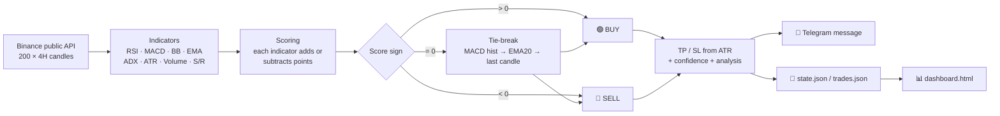
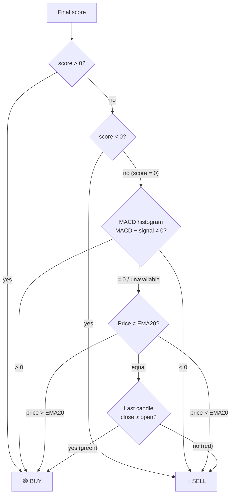
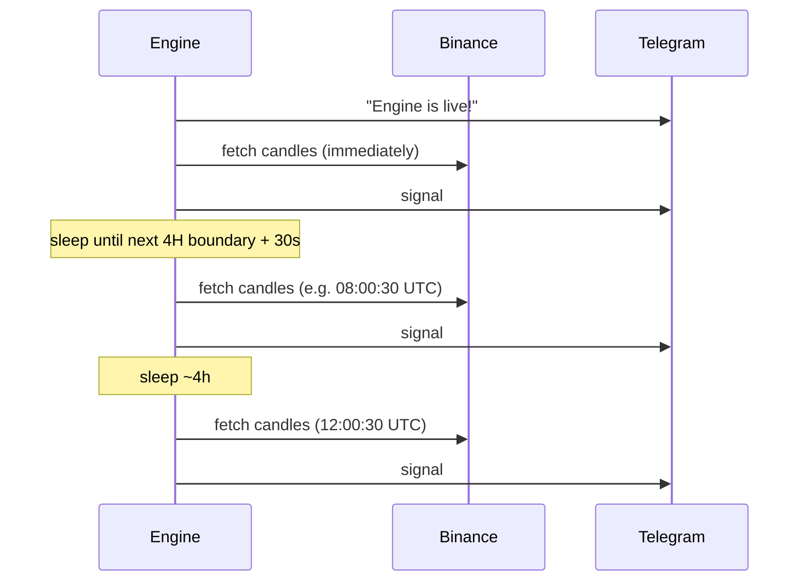

# BTC Signal Engine (4H)

A Python bot that looks at Bitcoin (BTC/USDT) every 4 hours and sends a **BUY or SELL signal** to Telegram. Each message also includes an entry price, take-profit, stop-loss, support/resistance levels, the indicator readings, a written analysis and a confidence score.

The bot **never sends HOLD**. Every cycle ends with a direction. When the edge is weak, the confidence score says so.

> ⚠️ This is a technical-analysis tool, not financial advice. Signals with a low confidence score (1–3/10) are close to a coin flip.

---

## Table of contents

1. [Project files](#1-project-files)
2. [The big picture](#2-the-big-picture)
3. [How data moves through the engine](#3-how-data-moves-through-the-engine)
4. [Step 1: Fetching market data](#4-step-1--fetching-market-data)
5. [Step 2: Calculating the indicators](#5-step-2--calculating-the-indicators)
6. [Step 3: The scoring system (how a decision is made)](#6-step-3--the-scoring-system-how-a-decision-is-made)
7. [Step 4: Turning the score into BUY or SELL](#7-step-4--turning-the-score-into-buy-or-sell)
8. [Step 5: Take-profit and stop-loss](#8-step-5--take-profit-and-stop-loss)
9. [Step 6: Confidence score](#9-step-6--confidence-score)
10. [Step 7: Written analysis and the Telegram message](#10-step-7--written-analysis-and-the-telegram-message)
11. [Step 8: Trade counting and saved state](#11-step-8--trade-counting-and-saved-state)
12. [Scheduling: when the engine runs](#12-scheduling--when-the-engine-runs)
13. [Error handling](#13-error-handling)
14. [A full worked example](#14-a-full-worked-example)
15. [The dashboard](#15-the-dashboard)
16. [Configuration reference](#16-configuration-reference)
17. [Running it](#17-running-it)
18. [Known limitations](#18-known-limitations)

---

## 1. Project files

| File | What it is |
|---|---|
| `signal_engine.py` | **The whole engine.** It fetches data, calculates indicators, decides the signal, sends it to Telegram and saves state. |
| `requirements.txt` | The single third-party dependency: `requests`. |
| `dashboard.html` | A web page you open on your own computer. It shows trade history from `data/trades.json`. |
| `data/state.json` | The engine's memory: how many trades so far and the last direction. Created automatically. |
| `data/trades.json` | A full log of every counted trade with all indicator values. Created on the first trade. |
| `logs/engine.log` | A text log of every cycle, every Telegram send and every error. |
| `PYTHONANYWHERE_SETUP.md` | A guide to hosting the engine 24/7 on PythonAnywhere. |
| `COWORK_TASK.md` | Setup notes written for Claude Cowork. They use Linux commands; on Windows, see [Running it](#17-running-it). |

---

## 2. The big picture



In one sentence: **candles go in, each indicator votes, the votes are added up, and the sign of the total decides BUY or SELL.**

---

## 3. How data moves through the engine

These are the functions in `signal_engine.py`, in the order the data passes through them:

```
main()
 ├─ send_telegram("Engine is live!")           ← startup message
 ├─ load_state()                               ← reads data/state.json
 └─ loop forever:
     ├─ run_cycle(state)
     │   ├─ fetch_candles()                    ← Binance → list of 200 candle dicts
     │   ├─ analyze(candles)                   ← candles → signal dict ("sig")
     │   │   ├─ rsi(), macd(), bollinger(), ema(), atr(), adx(), swing_levels()
     │   │   ├─ scoring → score + reasons
     │   │   ├─ score → action (BUY/SELL)
     │   │   ├─ dynamic_sl_tp()                ← TP/SL prices and %
     │   │   └─ confidence
     │   ├─ log.info(...)                      ← one summary line to engine.log
     │   ├─ trade counter update               ← maybe append_trade() to trades.json
     │   ├─ build_message(sig, trade_num)
     │   │   └─ written_analysis(sig)          ← plain-English paragraph
     │   ├─ send_telegram(msg)
     │   ├─ save_state(state)                  ← writes data/state.json
     │   └─ if trade_count ≥ 66 → goal message, stop
     └─ sleep until next 4H candle close + 30s
```

### The data at each step

**A candle** (from `fetch_candles`):
```python
{"time": "2026-10-12T08:00:00+00:00", "open": 82500.0, "high": 82900.0,
 "low": 82300.0, "close": 82678.01, "vol": 1234.5}
```

**The signal dict** (from `analyze`) is the central object. Everything after this step reads from it:
```python
{
  "action": "BUY",            "price": 82678.01,
  "tp_price": 85158.35,       "tp_pct": 3.0,
  "sl_price": 81851.23,       "sl_pct": 1.0,
  "support": 82285.71,        "resistance": 83173.29,
  "rsi": 42.71,
  "macd": -13.28, "signal": -82.1, "macd_state": "above signal (bullish)",
  "bb_upper": ..., "bb_lower": ...,
  "ema20": 83276.1, "ema50": 83558.03, "trend": "bearish",
  "atr": ..., "atr_pct": ...,
  "adx": 19.23, "plus_di": ..., "minus_di": ...,
  "vol_now": ..., "vol_avg": ..., "vol_ratio": 0.69,
  "score": 0, "confidence": 1,
  "reasons": ["MACD above signal", "EMA20 < EMA50 (downtrend)", ..., "tie-break: MACD histogram positive"],
  "timestamp": "2026-10-12 08:00 UTC"
}
```

---

## 4. Step 1: Fetching market data

`fetch_candles()` calls the Binance endpoint below. It is public, so no API key or account is needed:

```
GET https://api.binance.com/api/v3/klines?symbol=BTCUSDT&interval=4h&limit=200
```

- **200 candles of 4 hours each ≈ 33 days of history.** The slowest indicator (EMA50, ADX needs 29 bars) has more than enough data to warm up.
- Each raw Binance row is converted into the candle dict shown above. Only open, high, low, close, volume and open time are kept.
- If Binance fails (timeout, HTTP error), the error is raised and handled by the main loop. See [Error handling](#13-error-handling).

---

## 5. Step 2: Calculating the indicators

All indicators are written in plain Python with no pandas or TA-Lib. Only the **latest value** of each is used in the decision, except MACD, which also needs the previous value to detect crossovers.

| Indicator | Settings | Function | What it measures | How it is computed |
|---|---|---|---|---|
| **RSI** | 14 | `rsi()` | Momentum: is price overbought or oversold? | Wilder's smoothing of average gains vs. average losses. RSI = 100 − 100/(1 + avgGain/avgLoss). |
| **MACD** | 12, 26, 9 | `macd()` | Momentum direction and turning points | MACD line = EMA12 − EMA26. Signal line = EMA9 of the MACD line. Returns the current and previous values of both. |
| **Bollinger Bands** | 20, 2σ | `bollinger()` | Price stretched too far from its mean | Middle = SMA20; upper/lower = middle ± 2 × standard deviation of the last 20 closes. |
| **EMA 20 / EMA 50** | 20, 50 | `ema()` | Trend direction | Exponential moving averages, seeded with an SMA. EMA20 above EMA50 = uptrend. |
| **ATR** | 14 | `atr()` | Volatility in dollars | Wilder's average of the True Range (largest of: high−low, \|high−prev close\|, \|low−prev close\|). |
| **ADX, +DI, −DI** | 14 | `adx()` | Trend *strength* (ADX) and *which side* is stronger (+DI vs −DI) | Wilder's classic directional-movement method. |
| **Volume ratio** | 20 | inside `analyze()` | Is there real participation? | Current candle volume ÷ average volume of the last 20 candles. |
| **Support / Resistance** | 20 candles, fractal 2 | `swing_levels()` | Nearby price floors and ceilings | See below. |

### How support and resistance are found

`swing_levels()` looks at the **last 20 candles** and finds *fractal* swing points:

- A **swing high** is a candle whose high is ≥ the highs of the 2 candles before it **and** the 2 after it.
- A **swing low** is a candle whose low is ≤ the lows of the 2 candles before it **and** the 2 after it.

Then:
- **Support** = the *highest* swing low that is **at or below** the current price (the nearest floor).
- **Resistance** = the *lowest* swing high that is **at or above** the current price (the nearest ceiling).
- Fallbacks:
  - If no swing points exist, the window's lowest low and highest high are used.
  - If price has broken below every swing low, support = the lowest swing low.
  - If price has broken above every swing high, resistance = the highest swing high.

---

## 6. Step 3: The scoring system (how a decision is made)

This is the core of the engine, in `analyze()`. The score starts at **0**, and each indicator adds points (bullish) or subtracts points (bearish). Every rule that fires also adds a sentence to `reasons`, so you can see exactly why a signal was given.

The rules are applied **in this order**, and the order matters for volume (explained below):

| # | Rule | Condition | Points |
|---|---|---|---|
| 1 | **RSI** | RSI < 30 (deeply oversold) | **+2** |
| | | 30 ≤ RSI < 40 (leaning oversold) | **+1** |
| | | RSI > 70 (deeply overbought) | **−2** |
| | | 60 < RSI ≤ 70 (leaning overbought) | **−1** |
| | | 40–60 | 0 |
| 2 | **MACD** | Bullish crossover: MACD was below signal on the previous candle and is above it now | **+2** |
| | | Bearish crossover: was above, now below | **−2** |
| | | No crossover, MACD above signal | **+1** |
| | | No crossover, MACD below signal | **−1** |
| 3 | **Bollinger** | Price ≤ lower band (stretched down, likely bounce) | **+1** |
| | | Price ≥ upper band (stretched up, likely pullback) | **−1** |
| 4 | **EMA trend** | EMA20 > EMA50 (uptrend) | **+1** |
| | | EMA20 < EMA50 (downtrend) | **−1** |
| 5 | **ADX** | ADX ≥ 25 (strong trend) and +DI > −DI | **+1** |
| | | ADX ≥ 25 and −DI > +DI | **−1** |
| | | ADX < 20 | 0, noted as "weak/range" |
| 6 | **Volume** | Volume ≥ 1.5× average **and** score so far is positive | **+1** |
| | | Volume ≥ 1.5× average **and** score so far is negative | **−1** |
| | | Volume < 0.7× average | 0, noted as "thin" |
| 7 | **Support** | Price within 1% of support | **+1** |
| 8 | **Resistance** | Price within 1% of resistance | **−1** |

### Things to understand about the scoring

- **Two kinds of indicator.** RSI and Bollinger are *mean-reversion* signals: they bet on a bounce, so oversold = buy. EMA, MACD and ADX are *trend-following* signals: they bet on continuation. In a strong downtrend the two kinds often cancel out. This is why scores near 0 are common.
- **Volume is not an independent vote.** It only amplifies whichever side is already winning at that point (after rules 1–5). If the score is exactly 0 when volume is checked, high volume adds nothing.
- **Support and resistance can both fire.** In a tight range, price can be within 1% of both, giving +1 and −1, which cancel.
- **Possible range:** in theory −9 to +9. In practice, most cycles land between −4 and +4.

---

## 7. Step 4: Turning the score into BUY or SELL



- **Positive score → BUY (long). Negative score → SELL (short).**
- **A score of exactly 0 goes through a tie-break chain**, from the fastest momentum read to the slowest:
  1. **MACD histogram** (MACD − signal): positive → BUY, negative → SELL.
  2. **Price vs EMA20**: above → BUY, below → SELL.
  3. **Last candle colour**: green (close ≥ open) → BUY, red → SELL.
- The tie-break that decided it is added to `reasons`, for example `"tie-break: MACD histogram positive"`.

Because the chain always ends in a decision, **the engine can never produce HOLD.**

---

## 8. Step 5: Take-profit and stop-loss

`dynamic_sl_tp()` sizes TP and SL by **volatility**: quiet markets get tight targets and wild markets get wide ones.

**1. Measure volatility as a fraction of price:**
```
atr_pct = ATR / price
```

**2. Map it onto a 0→1 scale** between 1% and 3% ATR:
```
vol = (atr_pct − 0.01) / (0.03 − 0.01)      clamped to [0, 1]
```
| ATR as % of price | `vol` |
|---|---|
| ≤ 1.0% | 0.0 (calm) |
| 2.0% | 0.5 |
| ≥ 3.0% | 1.0 (very volatile) |

**3. Interpolate SL and TP:**
```
SL% = 1% + vol × (2% − 1%)     → between 1% and 2%
TP% = 3% + vol × (5% − 3%)     → between 3% and 5%
```
There is a hard safety check that SL% is always strictly smaller than TP%. With these settings, the reward:risk ratio is always between **2.5:1 and 3:1**.

**4. Convert to prices:**

| | Take-profit | Stop-loss |
|---|---|---|
| **BUY** | price × (1 + TP%) | price × (1 − SL%) |
| **SELL** | price × (1 − TP%) | price × (1 + SL%) |

**Example:** price $82,678 and ATR 1.2% of price → `vol` = 0.1 → SL = 1.1%, TP = 3.2%.

---

## 9. Step 6: Confidence score

```
adx_boost  = +1 if ADX ≥ 25,  −1 if ADX < 15,  else 0
confidence = clamp( min(|score|, 10) + adx_boost ,  1 … 10 )
```

| Score | ADX | Confidence | What it means |
|---|---|---|---|
| 0 (tie-break) | 19 | 1/10 | Indicators fully split; direction came from the tie-break. Very weak. |
| ±1 | 22 | 1/10 | Barely leaning. |
| ±3 | 28 | 4/10 | Moderate edge in a trending market. |
| ±5 | 30 | 6/10 | Strong confluence. |
| ±7 | 35 | 8/10 | Very strong confluence. |

**How to use it:** the engine *always* gives a direction, so the confidence number is your filter. A practical rule is full size only at ≥ 5/10, reduced size at 3–4, and skip or very small size at 1–2.

---

## 10. Step 7: Written analysis and the Telegram message

### Written analysis

`written_analysis()` turns the numbers into a paragraph covering trend, trend strength, momentum, MACD state, volume, volatility, key levels and a verdict. The thresholds behind the wording:

| Topic | Wording thresholds |
|---|---|
| Momentum (RSI) | < 30 deeply oversold · < 45 leans oversold · 45–55 neutral · > 55 leans overbought · > 70 deeply overbought |
| Trend strength (ADX) | ≥ 40 very strong · ≥ 25 strong · ≥ 20 developing · < 20 weak/ranging |
| Volume ratio | ≥ 1.5× elevated · ≥ 1.0× in line · ≥ 0.7× slightly thin · < 0.7× notably thin |
| Volatility (ATR %) | ≥ 2.5% high · ≥ 1.5% moderate · < 1.5% low |
| Verdict | \|score\| ≥ 4 "strong confluence" · ≥ 2 "moderate edge" · < 2 "mixed, low conviction — consider reduced size or a tighter stop" |

### Telegram message

`build_message()` puts everything together, and `send_telegram()` posts it through the Telegram Bot API (`sendMessage`, Markdown formatting). Example:

```
🟢 BTC/USDT 4H — LONG (BUY)

💰 Position size: 100% of capital
📍 Entry:        $82,678.01
🎯 Take Profit:  $85,158.35  (+3.0%)
🛑 Stop Loss:    $81,851.23  (-1.0%)

🟩 Support:      $82,285.71
🟥 Resistance:   $83,173.29

📊 Indicators
  RSI(14):   42.71
  MACD:      -13.28 | Signal: -82.1  (above signal (bullish))
  EMA20/50:  83276.1 / 83558.03  (bearish)
  Bollinger: upper … · lower …
  ATR(14):   …  (…% of price)
  ADX(14):   19.23  (+DI … · -DI …)
  Volume:    0.69x vs 20-avg

🧠 Analysis
BTC is trading at $82,678.01 on the 4H. The EMA20/EMA50 relationship shows a bearish trend … 

🔥 Confidence: 1/10
📈 Trade #1 of 66 — 65 remaining
🕐 2026-10-12 08:00 UTC
```

The engine also sends these Telegram messages:
- A **startup** message when it launches.
- A **warning** message on network or unexpected errors.
- A **goal reached** message when 66 trades are completed.

---

## 11. Step 8: Trade counting and saved state

The engine works towards a goal of **66 trades**. A trade is counted **only when the direction flips**:

```
cycle:   1     2     3     4     5     6
signal:  BUY   BUY   BUY   SELL  SELL  BUY
counted: #1    –     –     #2    –     #3
```

Repeated signals in the same direction mean "the same position is still on". They are still sent to Telegram but do not add to the count.

### `data/state.json`
```json
{ "trade_count": 3, "last_action": "BUY" }
```
- Read once at startup (`load_state`) and written after every cycle (`save_state`).
- Because this is saved to disk, **the counter survives restarts**. To restart from zero, stop the engine and set `trade_count` to `0` and `last_action` to `null`.

### `data/trades.json`
A list with one entry per counted trade. Each entry is the full signal dict plus a `trade` number:
```json
[ { "trade": 1, "action": "BUY", "price": 82678.01, "tp_price": 85158.35, ... , "reasons": [...] } ]
```

### `logs/engine.log`
One line per cycle, for example:
```
2026-10-12 08:00:33 | INFO | BTC=$82,678.01 | BUY | score=0 | RSI=42.71 | ADX=19.23 | ATR%=… | conf=1/10
2026-10-12 08:00:36 | INFO | Telegram message sent.
2026-10-12 08:00:36 | INFO | Sleeping 14394s until next 4H cycle...
```

When the count reaches 66, the engine sends the goal message, sets `done: true` and exits its loop.

---

## 12. Scheduling: when the engine runs



- **On startup** it runs one cycle immediately, whatever the time.
- After that it sleeps until the next **4H candle close in UTC**: 00:00, 04:00, 08:00, 12:00, 16:00, 20:00, **plus 30 seconds** so Binance has finalised the candle.
- In local time this depends on your timezone. For example, UTC+3 gives 03:00, 07:00, 11:00, 15:00, 19:00, 23:00 (+30s).
- Setting `ALIGN_TO_CANDLE_CLOSE = False` switches to a plain 4-hour sleep counted from the end of the last cycle.

---

## 13. Error handling

| Problem | What happens |
|---|---|
| Binance or network error (`requests` exception) | Logged and a ⚠️ "Network error" Telegram message is attempted. The engine **keeps running** and tries again at the next 4H boundary. |
| Any other error in a cycle | Logged with full traceback and a ⚠️ "Engine error" Telegram message is attempted. The engine keeps running. |
| Telegram send fails | Logged (`Telegram HTTP …` or `Telegram send failed`). The cycle continues and state is still saved. |
| `state.json` corrupt or missing | Starts again from `{trade_count: 0, last_action: null}`. |
| `trades.json` corrupt | Starts a fresh list. |

A failed cycle is **not retried early**. The next attempt is at the next 4H boundary.

---

## 14. A full worked example

This is real output from a test run on live Binance data:

| Rule | Reading | Points |
|---|---|---|
| RSI | 42.71 (between 40 and 60) | 0 |
| MACD | −13.28 vs signal −82.1 → above signal, no crossover | **+1** |
| Bollinger | price inside the bands | 0 |
| EMA | EMA20 83,276 < EMA50 83,558 → downtrend | **−1** |
| ADX | 19.23 (< 20, weak/range) | 0 |
| Volume | 0.69× average → thin | 0 |
| Support | price within 1% of 82,285.71 | **+1** |
| Resistance | price within 1% of 83,173.29 | **−1** |
| **Total** | | **0** |

- **Decision:** the score is 0, so the tie-break runs. The MACD histogram (−13.28 − (−82.1) = +68.8) is positive → **BUY**.
- **TP/SL:** ATR was below 1% of price (a calm market), so `vol` = 0, TP = +3.0% and SL = −1.0%: the tightest settings.
- **Confidence:** |0| + 0 (ADX between 15 and 25) → clamped to **1/10**.
- **Reading it:** the engine leans long because short-term momentum (MACD) is turning up. The trend is still down and price is stuck between support and resistance, so this is a low-conviction trade.

---

## 15. The dashboard

`dashboard.html` is a static page that reads `data/trades.json` and shows:
- Total trades, BUY count, SELL count, last price and time.
- A progress bar toward 66 trades.
- The last 25 trades in a table. It refreshes every 30 seconds.

Browsers block pages opened with `file://` from reading local files, so serve the folder first:
```powershell
cd "C:\Users\Mazen ISMAIL\Documents\Claude_Trading\Trading_BTC"
python -m http.server 8000
```
Then open <http://localhost:8000/dashboard.html>.

---

## 16. Configuration reference

All settings are constants at the top of `signal_engine.py`. Restart the engine after changing any of them.

| Constant | Default | Meaning |
|---|---|---|
| `TELEGRAM_TOKEN` | env var | Bot token from @BotFather, read from the `TELEGRAM_TOKEN` environment variable. **Never put it in the code.** |
| `TELEGRAM_CHAT_ID` | env var | The chat that receives the messages, read from the `TELEGRAM_CHAT_ID` environment variable. |
| `SYMBOL` | `BTCUSDT` | Binance trading pair. |
| `INTERVAL` | `4h` | Candle timeframe (`15m`, `1h`, `4h`, …). If you change it, also change the scheduling logic, which assumes 4H boundaries. |
| `CANDLES` | `200` | History downloaded per cycle. |
| `SL_MIN_PCT` / `SL_MAX_PCT` | 1% / 2% | Stop-loss range. |
| `TP_MIN_PCT` / `TP_MAX_PCT` | 3% / 5% | Take-profit range. |
| `ATR_LOW_PCT` / `ATR_HIGH_PCT` | 1% / 3% | Volatility range mapped onto the SL/TP ranges. |
| `GOAL_TRADES` | `66` | The engine stops after this many counted trades. |
| `SLEEP_BETWEEN_CYCLES` | 4h | Used only when alignment is off. |
| `ALIGN_TO_CANDLE_CLOSE` | `True` | Run right after each 4H candle closes. |
| `CANDLE_CLOSE_BUFFER_SEC` | `30` | Seconds to wait after the candle close. |

Scoring thresholds (RSI 30/40/60/70, ADX 20/25, volume 0.7×/1.5×, S/R 1%) are written directly inside `analyze()`.

---

## 17. Running it

### Locally on Windows (PowerShell)

```powershell
cd "C:\Users\Mazen ISMAIL\Documents\Claude_Trading\Trading_BTC"
python -m pip install -r requirements.txt     # first time only

# Telegram credentials — first time only (saved for future terminals; reopen the terminal afterwards)
setx TELEGRAM_TOKEN "your-bot-token"
setx TELEGRAM_CHAT_ID "your-chat-id"

$env:PYTHONUTF8 = "1"                          # avoids emoji encoding errors on Windows
python signal_engine.py                        # Ctrl+C to stop
```

Run it in the background, with no window:
```powershell
$env:PYTHONUTF8 = "1"
Start-Process pythonw -ArgumentList "signal_engine.py" -WorkingDirectory "C:\Users\Mazen ISMAIL\Documents\Claude_Trading\Trading_BTC" -WindowStyle Hidden
```

Watch the log:
```powershell
Get-Content logs\engine.log -Tail 20 -Wait
```

Stop the background engine:
```powershell
Get-CimInstance Win32_Process -Filter "Name like 'python%'" | Where-Object CommandLine -like "*signal_engine.py*" | ForEach-Object { Stop-Process -Id $_.ProcessId }
```

Your PC must stay awake for signals to keep arriving. Run **only one copy** of the engine, locally or on a server, or you will get duplicate messages.

### 24/7 in the cloud

See [PYTHONANYWHERE_SETUP.md](PYTHONANYWHERE_SETUP.md).

---

## 18. Known limitations

- **The latest candle is still open.** Binance's `klines` response includes the candle that is currently forming. Because the engine runs 30 seconds after a close, the last candle in the data is only ~30 seconds old:
  - `price` is effectively the latest market price. That is fine for an entry.
  - The **volume ratio** compares 30 seconds of volume with full 4-hour candles, so it is almost always "thin". The volume rule (+1/−1) therefore rarely fires.
  - RSI, MACD, Bollinger and EMA include that just-opened candle. Its effect is small.
- **It is a 4H system.** Targets of 3–5% and a 4-hour cadence suit swing trading more than intraday trading. Day trading needs a shorter `INTERVAL`, smaller TP/SL ranges and adjusted scheduling.
- **It is forced to always pick a side.** In a sideways market the signals may flip often and carry low confidence. Use the confidence score as your filter.
- **There is no backtest and no live P&L tracking.** The engine does not check whether a TP or SL was actually hit. `trades.json` records entries only.
- **"100% of capital" is only text in the message.** The engine places no orders and holds no exchange keys.
- **Credentials come from environment variables.** The engine exits at startup if `TELEGRAM_TOKEN` or `TELEGRAM_CHAT_ID` is missing. `logs/` and `data/` are git-ignored because error tracebacks in the log can contain the token.
- **The dashboard's TP and SL columns show "—".** The dashboard reads `tp`/`sl`, but the engine saves `tp_price`/`sl_price`.
